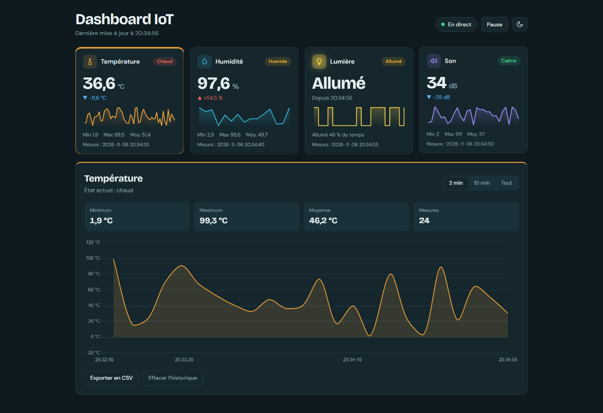
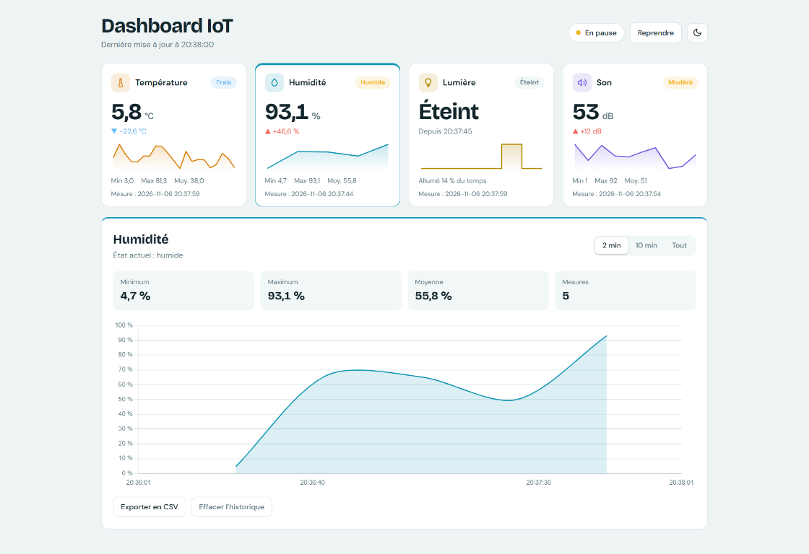

# Simulateur IoT

Projet C++ qui simule un serveur
recevant les mesures de plusieurs capteurs IoT et les enregistre dans des
fichiers CSV.

## Fonctionnalités

- Simulation de quatre types de capteurs :
  - température ;
  - humidité ;
  - niveau sonore ;
  - luminosité.
- Génération de valeurs aléatoires pour chaque mesure.
- Affichage des mesures dans la console.
- Enregistrement des mesures dans un fichier CSV par type de capteur.
- Attribution automatique d'un identifiant unique à chaque capteur.
- Exécution périodique de la simulation grâce à un ordonnanceur
  (`Scheduler`).
- Visualisation des mesures dans une interface graphique web.

## Architecture

```text
Projet/
├── CMakeLists.txt
├── Headers/
│   ├── HumiditySensor.h
│   ├── LightSensor.h
│   ├── Scheduler.h
│   ├── Sensor.h
│   ├── Server.h
│   ├── SoundSensor.h
│   └── TemperatureSensor.h
├── Sources/
│   ├── HumiditySensor.cpp
│   ├── LightSensor.cpp
│   ├── Scheduler.cpp
│   ├── Sensor.cpp
│   ├── Server.cpp
│   ├── SoundSensor.cpp
│   ├── TemperatureSensor.cpp
│   └── main.cpp
├── Frontend/
│   ├── app.js
│   ├── index.html
│   └── style.css
├── docs/
│   └── images/
│       ├── dashboard-dark.png
│       └── dashboard-light.png
├── Humidity.csv
├── Light.csv
├── Sound.csv
└── Temperature.csv
```

### Rôle des principales classes

- `Sensor` : classe abstraite commune à tous les capteurs.
- `TemperatureSensor`, `HumiditySensor`, `SoundSensor` et `LightSensor` :
  implémentations concrètes des capteurs.
- `Server` : affiche les mesures et les écrit dans les fichiers CSV.
- `Scheduler` : conserve la liste des capteurs et déclenche leurs mises à
  jour.
- `main.cpp` : initialise le serveur, les capteurs et l'ordonnanceur.

## Interface graphique

Le projet inclut un tableau de bord web accessible à l'adresse
`http://localhost:8080/` lorsque le programme est lancé. Il récupère les
dernières mesures depuis l'API `/api/sensors` et les présente dans quatre
cartes dédiées :

- **Température** : valeur en degrés Celsius, état et tendance ;
- **Humidité** : pourcentage, état et statistiques ;
- **Lumière** : état allumé ou éteint et durée relative ;
- **Son** : niveau sonore en décibels et tendance.

Chaque carte affiche la dernière mesure reçue, sa date, un aperçu graphique,
ainsi que les valeurs minimale, maximale et moyenne disponibles. Cliquer sur
une carte ouvre le détail du capteur avec un graphique plus grand. La période
affichée peut être réglée sur **2 minutes**, **10 minutes** ou **Toutes les
mesures**.

Le tableau de bord propose également :

- un bouton **Pause/Reprendre** pour suspendre ou relancer l'actualisation ;
- un bouton de changement de thème clair ou sombre ;
- l'export de l'historique du capteur sélectionné au format CSV ;
- l'effacement de l'historique conservé dans le navigateur.

L'interface interroge régulièrement le serveur, mais une valeur n'est ajoutée
à l'historique que lorsqu'une nouvelle mesure du capteur est disponible. Les
capteurs conservent ainsi leurs propres périodes de mesure :

- température : toutes les `5` secondes ;
- son : toutes les `10` secondes ;
- lumière : toutes les `15` secondes ;
- humidité : toutes les `20` secondes.

### Captures de l'interface

#### Thème sombre



#### Thème clair



## Prérequis

- Un compilateur compatible avec **C++17** :
  - Visual Studio 2019 ou ultérieur sous Windows ;
  - GCC ou Clang sous Linux/macOS.
- CMake 3.10 ou ultérieur.

## Compilation avec CMake

Depuis le dossier `Projet` :

```bash
cmake -S . -B build
cmake --build build
```

Sous Windows avec Visual Studio, il peut être nécessaire de préciser le
générateur :

```powershell
cmake -S . -B build -G "Visual Studio 17 2022"
cmake --build build --config Release
```

## Exécution

Depuis le dossier `Projet` :

### Windows

Avec une compilation Visual Studio :

```powershell
.\build\Release\simulator.exe
```

Avec une compilation MinGW ou Ninja :

```powershell
.\build\simulator.exe
```

### Linux/macOS

```bash
./build/simulator
```

La simulation s'exécute en continu. Pour l'arrêter, utilisez `Ctrl+C`.

## Format des données

Chaque mesure est ajoutée au fichier CSV correspondant au type du capteur :

- `Temperature.csv`
- `Humidity.csv`
- `Sound.csv`
- `Light.csv`

Les fichiers utilisent le séparateur `;` et contiennent les colonnes
suivantes :

```text
Date;Heure;SensorId;SensorType;Valeur
```

Les mesures sont également affichées dans la console sous la forme :

```text
Server = Server1 ;; Sensor = 1 ;; Type = Temperature ;; Valeur = 42.500000
```

## Fonctionnement de la simulation

Au démarrage, le programme :

1. crée un serveur nommé `Server1` ;
2. crée un capteur de chaque type ;
3. ajoute les capteurs à l'ordonnanceur ;
4. vérifie les capteurs toutes les secondes ;
5. déclenche chaque capteur selon sa propre période, puis transmet les
   nouvelles valeurs au serveur pour affichage et sauvegarde.

Les valeurs générées sont aléatoires :

- température et humidité : valeur décimale comprise entre `0` et `100` ;
- niveau sonore : entier compris entre `0` et `100` ;
- luminosité : `true` ou `false`.

## Nettoyage des fichiers générés

Les fichiers CSV sont ouverts en mode ajout. Pour repartir d'une simulation
vierge, supprimez ou videz les fichiers suivants avant de relancer le
programme :

```text
Humidity.csv
Light.csv
Sound.csv
Temperature.csv
```

Ils seront recréés avec leur en-tête lors de la prochaine écriture.
