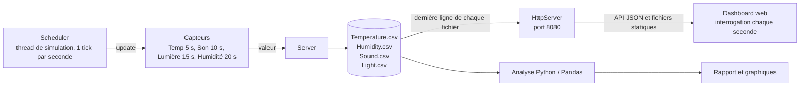
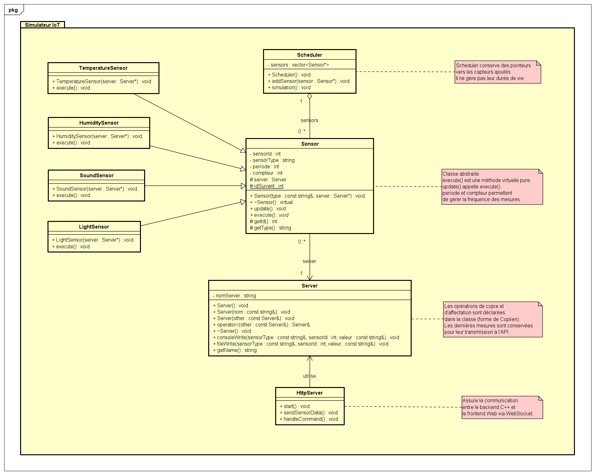
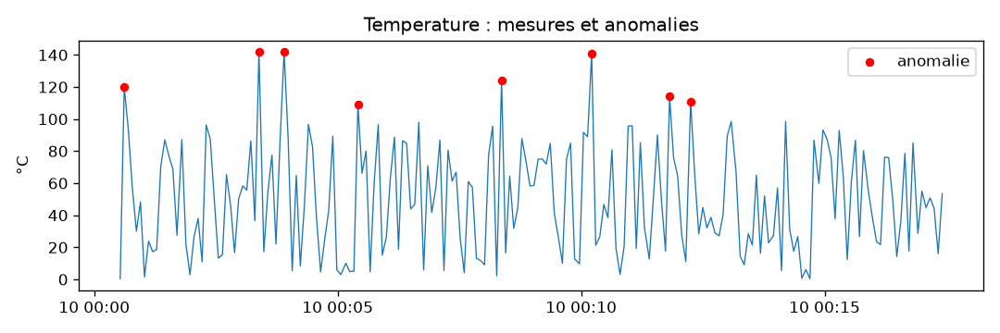

# Simulateur IoT AP4A


Projet C++17 simulant un système de capteurs IoT. Le programme génère des
mesures, les enregistre dans des fichiers CSV et les expose dans un dashboard
web servi directement par le simulateur.

## Fonctionnalités

- Simulation de quatre capteurs :
  - température, en °C ;
  - humidité, en % ;
  - niveau sonore, en dB ;
  - luminosité, allumée ou éteinte.
- Génération périodique de mesures aléatoires.
- Identifiant unique attribué à chaque capteur.
- Sauvegarde des mesures dans des fichiers CSV séparés.
- Serveur HTTP natif en C++ accessible sur le port `8080`.
- API JSON `GET /api/sensors` pour récupérer la dernière mesure de chaque
  capteur.
- Dashboard web avec :
  - quatre cartes de capteurs ;
  - tendances, min/max/moyenne et graphiques ;
  - sélection d'une période de 2 minutes, 10 minutes ou de tout l'historique ;
  - pause et reprise de l'actualisation ;
  - thème clair ou sombre ;
  - export de l'historique du navigateur au format CSV ;
  - effacement de l'historique local.
- Mode de test permettant d'injecter des valeurs anormales.
- Script Python d'analyse statistique avec génération de graphiques et
  détection d'anomalies.
- Exécution locale ou dans Docker.
- Intégration continue avec GitHub Actions : compilation, analyse et test de
  l'image Docker.

## Architecture

### Flux de données



Le `Server` n'a aucun lien direct avec le navigateur : il écrit les mesures
dans les CSV, et c'est le `HttpServer` qui relit ces fichiers pour répondre à
l'API.

### Arborescence

```text
Projet/
├── .github/workflows/ci.yml
├── .dockerignore
├── .gitignore
├── CMakeLists.txt
├── Dockerfile
├── docker-compose.yml
├── Headers/
│   ├── HttpServer.h
│   ├── HumiditySensor.h
│   ├── LightSensor.h
│   ├── Scheduler.h
│   ├── Sensor.h
│   ├── Server.h
│   ├── SoundSensor.h
│   └── TemperatureSensor.h
├── Sources/
│   ├── HttpServer.cpp
│   ├── HumiditySensor.cpp
│   ├── LightSensor.cpp
│   ├── Scheduler.cpp
│   ├── Sensor.cpp
│   ├── Server.cpp
│   ├── SoundSensor.cpp
│   ├── TemperatureSensor.cpp
│   └── main.cpp
├── Frontend/
│   ├── app.js
│   ├── index.html
│   └── style.css
├── analysis/
│   ├── analyze.py
│   └── requirements.txt
├── data/sample/
│   ├── Humidity.csv
│   ├── Light.csv
│   ├── Sound.csv
│   └── Temperature.csv
├── docs/
│   ├── ClassDiagram.png
│   ├── analysis/
│   └── images/
└── *.csv    # générés à la racine à l'exécution, ignorés par Git
```

### Rôle des composants

- `Sensor` : classe abstraite commune, gestion de l'identifiant et de la
  période de mesure.
- `TemperatureSensor`, `HumiditySensor`, `SoundSensor` et `LightSensor` :
  implémentations concrètes des capteurs.
- `Scheduler` : vérifie les capteurs toutes les secondes et déclenche les
  mesures dues.
- `Server` : affiche et écrit les mesures dans les fichiers CSV.
- `HttpServer` : sert le frontend et l'endpoint JSON, en lisant la dernière
  ligne de chaque fichier CSV.
- `Frontend/` : interface web et historique conservé dans `localStorage`.
- `analysis/analyze.py` : analyse les fichiers CSV et produit un rapport.

### Diagramme de classes



## Périodes de mesure

Chaque capteur est interrogé par le scheduler toutes les secondes, mais ne
produit une nouvelle mesure qu'à sa période :

| Capteur | Période |
| --- | ---: |
| Température | 5 secondes |
| Son | 10 secondes |
| Lumière | 15 secondes |
| Humidité | 20 secondes |

Les valeurs normales sont comprises entre `0` et `100` pour la température,
l'humidité et le son. La luminosité est représentée par `true` ou `false`.

## Dashboard et API

Lancer le simulateur permet d'accéder au dashboard à l'adresse
[`http://localhost:8080/`](http://localhost:8080/).

| Méthode | Endpoint | Description |
| --- | --- | --- |
| GET | `/` | Dashboard web |
| GET | `/api/sensors` | Dernière mesure de chaque capteur |

Exemple de réponse de `GET /api/sensors`. Les valeurs sont des chaînes de
caractères :

```json
{
  "temperature": { "value": "93.199997", "date": "2026-11-11 17:27:32" },
  "humidity": { "value": "61.330002", "date": "2026-11-11 17:27:32" },
  "light": { "value": "false", "date": "2026-11-11 17:27:22" },
  "sound": { "value": "56", "date": "2026-11-11 17:27:32" }
}
```

Tant qu'un capteur n'a produit aucune mesure (le fichier CSV n'existe pas
encore), son entrée est de la forme
`{ "value": null, "date": null, "error": "file not found" }`.

Le navigateur interroge l'API chaque seconde, mais n'ajoute une valeur à son
historique que lorsqu'une nouvelle date de mesure est reçue. L'historique est
limité aux mesures récentes et conservé localement dans le navigateur.

## Prérequis

### Compilation native

- CMake `3.10` ou ultérieur ;
- compilateur compatible avec C++17 :
  - Visual Studio 2019 ou ultérieur sous Windows ;
  - GCC ou Clang sous Linux/macOS.

### Analyse des données

- Python 3 ;
- les dépendances de `analysis/requirements.txt` :
  - `pandas` ;
  - `matplotlib`.

### Docker

Docker et Docker Compose sont nécessaires pour l'exécution conteneurisée.

## Compilation et exécution avec CMake

Depuis le dossier `Projet` :

```bash
cmake -S . -B build
cmake --build build
```

Sous Windows avec Visual Studio :

```powershell
cmake -S . -B build -G "Visual Studio 17 2022"
cmake --build build --config Release
```

### Lancement

Windows avec Visual Studio :

```powershell
.\build\Release\simulator.exe
```

Windows avec MinGW ou Ninja :

```powershell
.\build\simulator.exe
```

Linux/macOS :

```bash
./build/simulator
```

Le programme fonctionne en continu. Utiliser `Ctrl+C` pour l'arrêter.

## Mode d'injection d'anomalies

Le mode normal ne génère que des valeurs comprises entre `0` et `100`. Pour
tester l'analyse des anomalies, lancer le simulateur avec l'argument
`--inject-anomalies` :

```powershell
.\build\simulator.exe --inject-anomalies
```

Pour les trois capteurs numériques (température, humidité, son), une valeur
supérieure à `100` (environ de `101` à `150`) est alors injectée en moyenne une
fois sur 50 mesures. La proportion varie d'un échantillon à l'autre. Le
capteur de luminosité est booléen : il n'est pas concerné par l'injection.

Le mode peut également être activé avec Docker :

```yaml
command: ["./simulator", "--inject-anomalies"]
```

Cette ligne est déjà présente en commentaire dans `docker-compose.yml`.

## Analyse Python

Installer les dépendances :

```bash
python -m pip install -r analysis/requirements.txt
```

Analyser les données d'exemple :

```bash
python analysis/analyze.py data/sample
```

Analyser les CSV générés à la racine du projet :

```bash
python analysis/analyze.py .
```

Les quatre fichiers CSV doivent exister : laisser tourner le simulateur au
moins 20 secondes avant de lancer l'analyse.

Le script produit dans `docs/analysis/` :

- `report.md`, un rapport statistique ;
- un graphique PNG par capteur numérique ;
- `anomalies.csv`, la liste des mesures détectées.

Deux types d'anomalies sont détectés pour les capteurs numériques :

- **hors plage** : la valeur sort de la plage normale du simulateur `[0, 100]` ;
- **pic statistique** : le z-score de la valeur dépasse `3` par rapport aux
  20 mesures précédentes (fenêtre glissante).

Une valeur hors plage est une anomalie par rapport à la plage définie dans le
simulateur, pas nécessairement une anomalie physique réelle. Pour la
luminosité, le rapport indique la part du temps allumé et le nombre de
changements d'état.

### Résultats sur les données d'exemple

Les CSV de `data/sample/` ont été générés avec `--inject-anomalies` pendant
environ 17 minutes :

| Capteur | Mesures | Anomalies détectées |
| --- | ---: | --- |
| Température | 201 | 8 (4,0 %) |
| Humidité | 50 | 1 (2,0 %) |
| Son | 100 | 1 (1,0 %) |
| Lumière | 67 | sans objet (allumée 52,2 % du temps, 29 changements d'état) |

Les 10 anomalies sont des valeurs hors plage injectées par le mode de test.
Les valeurs normales étant tirées uniformément entre `0` et `100`, aucun pic
statistique supplémentaire n'est détecté hors injection.

Rapport complet : [`docs/analysis/report.md`](docs/analysis/report.md)



## Exécution avec Docker

Construire et démarrer le service :

```bash
docker compose up --build
```

Le dashboard est ensuite disponible à
[`http://localhost:8080/`](http://localhost:8080/).

Pour activer l'injection d'anomalies, décommenter `command` dans
`docker-compose.yml`, puis relancer le service :

```bash
docker compose up --build
```

Arrêter le service :

```bash
docker compose down
```

Les fichiers CSV sont écrits dans le conteneur et disparaissent avec lui.

## Intégration continue

À chaque `push` sur `main` et à chaque pull request, GitHub Actions
(`.github/workflows/ci.yml`) exécute trois jobs :

| Job | Vérification |
| --- | --- |
| Compilation C++ (CMake) | Le projet compile sous Linux. |
| Analyse Python / Pandas | Le script d'analyse s'exécute sur `data/sample` et le rapport est conservé comme artefact. |
| Image Docker et test de fumée | L'image se construit, le conteneur démarre, puis le dashboard et `/api/sensors` répondent avec une mesure de température. |

## Format des fichiers CSV

Chaque mesure est ajoutée au fichier correspondant :

- `Temperature.csv`
- `Humidity.csv`
- `Sound.csv`
- `Light.csv`

Les fichiers utilisent `;` comme séparateur et cette structure :

```text
Date;Heure;SensorId;SensorType;Valeur
```

Exemple d'affichage dans la console :

```text
Server = Server1 ;; Sensor = 1 ;; Type = Temperature ;; Valeur = 42.500000
```

## Nettoyage des données

Les fichiers CSV sont ouverts en mode ajout. Pour recommencer une simulation,
supprimer ou vider les fichiers suivants :

```text
Humidity.csv
Light.csv
Sound.csv
Temperature.csv
```

Ils seront recréés avec leur en-tête lors de la prochaine écriture.

L'historique du dashboard est indépendant des fichiers CSV et peut être
effacé avec le bouton **Effacer l'historique**.

## Limites connues

- Les mesures sont tirées au hasard, sans modèle physique : il s'agit d'une
  simulation pour tester la chaîne de collecte, de visualisation et d'analyse.
- Les anomalies de l'analyse sont celles injectées par le mode de test ;
  l'analyse n'a pas été évaluée sur des mesures réelles.
- Dans Docker, les CSV ne sont pas conservés après l'arrêt du conteneur.

## Captures

### Thème sombre


### Thème clair

