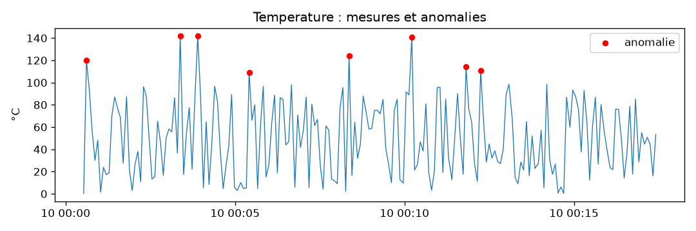
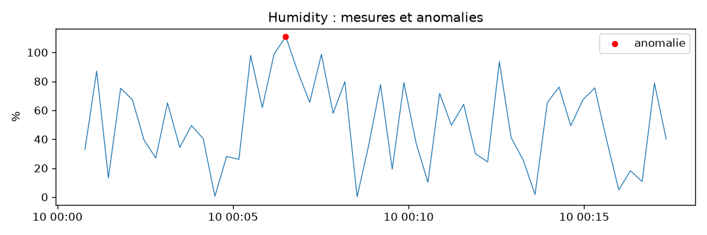
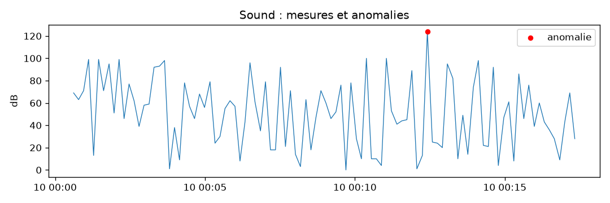

# Rapport d'analyse des mesures simulées

## Temperature (°C)

- mesures : 201
- moyenne : 49.96, écart-type : 33.31
- min : 0.38, médiane : 46.87, max : 142.00
- anomalies : 8 (4.0 %)

## Humidity (%)

- mesures : 50
- moyenne : 50.62, écart-type : 29.67
- min : 0.22, médiane : 49.38, max : 111.00
- anomalies : 1 (2.0 %)

## Sound (dB)

- mesures : 100
- moyenne : 50.65, écart-type : 30.70
- min : 0.00, médiane : 50.00, max : 124.00
- anomalies : 1 (1.0 %)

## Light (allumé / éteint)

- mesures : 67
- part du temps allumé : 52.2 %
- changements d'état : 29
